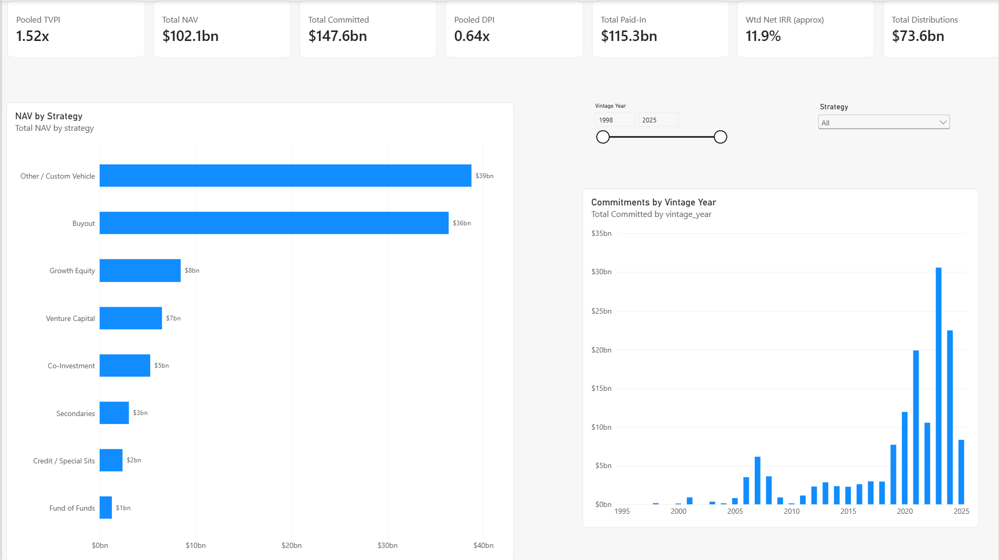
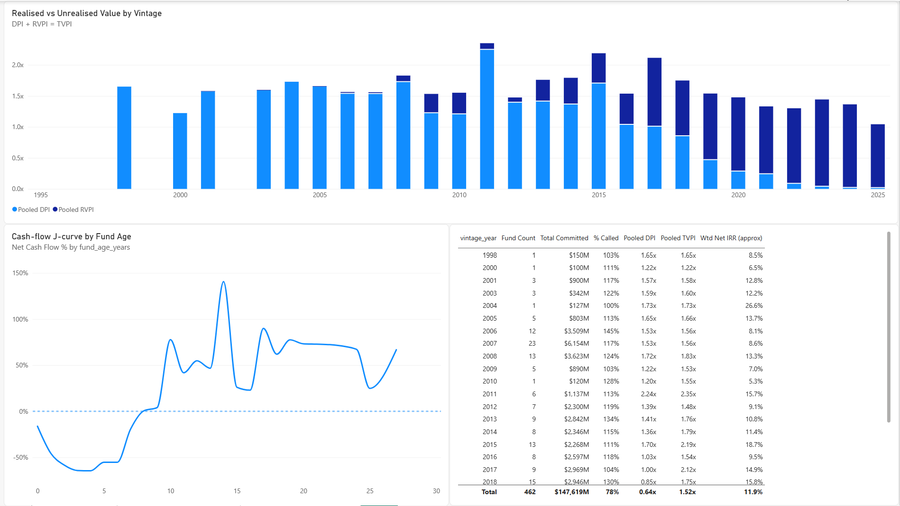
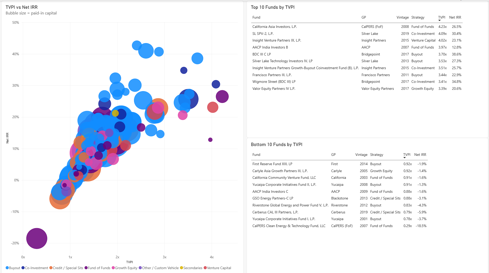

# Private Equity Fund Performance Dashboard

An end-to-end analytics project on **CalPERS' private equity portfolio**, built with Python, SQL (SQLite) and Power BI.
It turns a public LP disclosure table into a cleaned, classified dataset and an interactive dashboard tracking
the standard PE performance metrics: **TVPI, DPI, RVPI and net IRR**, by vintage year, strategy and GP.

> Data as of **30 September 2025** · 462 active funds · vintages 1998–2025 · $147.6B committed



---

## Key findings

| Metric | Value |
|---|---|
| Total committed | $147.6B |
| Paid-in capital | $115.3B |
| Distributions | $73.6B |
| Remaining value (NAV) | $102.1B |
| **Pooled TVPI** | **1.52x** |
| **Pooled DPI** | **0.64x** |
| Paid-in-weighted net IRR (approx.) | 11.9% |

- **Validation:** The pooled TVPI of 1.52x calculated in this project matches the net multiple of 1.5x that CalPERS reports for the program, confirming the cleaning and aggregation logic.
- **A young portfolio:** 275 of 462 funds (60%) are flagged as early-stage by CalPERS. Most of the portfolio is still at the bottom of the J-curve, which is why DPI (0.64x) is well below TVPI. Most of the value is still unrealised NAV.
- **Custom vehicles are the largest bucket:** Funds classified as *Other / Custom Vehicle* hold the largest share of NAV (roughly 38%), ahead of Buyout. These are mostly separately managed accounts and co-investment structures whose names do not reveal their underlying strategy (see the methodology note below).
- **Commitment surge after 2020:** Commitments from the 2021–2024 vintages dwarf earlier years, with roughly $30B in the 2023 vintage alone. Older vintages look smaller partly because fully exited funds drop out of the table (survivorship).
- **The J-curve in real data:** Net cash flow as a share of commitment falls to roughly −60% in years 3–5 while capital is called, then breaks even at around **year 8–9** as distributions arrive.
- **Manager selection matters:** The worst performer is CalPERS' own *Clean Energy & Technology Fund* (0.29x TVPI, −18.5% net IRR). Three Yucaipa funds appear in the bottom 10. Several co-investment vehicles rank in the top 10, consistent with their lower fee load.

## Metrics

| Metric | Formula | What it tells you |
|---|---|---|
| **DPI** (Distributions / Paid-In) | Distributions ÷ Paid-in | Cash actually returned to the LP (realised) |
| **RVPI** (Residual Value / Paid-In) | NAV ÷ Paid-in | Value still held in the fund (unrealised) |
| **TVPI** (Total Value / Paid-In) | (Distributions + NAV) ÷ Paid-in = DPI + RVPI | Total multiple on invested capital |
| **Net IRR** | Reported by CalPERS per fund | Time-weighted return; less meaningful for young funds |

**Pooled, not averaged.** All portfolio-level multiples are *pooled*: the sum of values divided by the sum of
paid-in capital. They are not a simple average of fund-level ratios, which would over-weight small funds.

```DAX
Pooled TVPI = DIVIDE([Total Distributions] + [Total NAV], [Total Paid-In])
```

**IRR caveat.** A true portfolio IRR requires dated cash flows, which the public table does not provide. The
dashboard shows a **paid-in-weighted average of fund net IRRs**, excluding funds CalPERS marks as not yet
meaningful (N/M or early-stage). It is labelled as an approximation.

## Methodology

### 1. Data source
[CalPERS Private Equity Program Fund Performance Review](https://www.calpers.ca.gov/investments/about-investment-office/investment-organization/pep-fund-performance).
For each active fund the table lists vintage year, capital committed, cash in, cash out, cash out plus remaining value, net IRR and investment multiple.
The live page was unavailable at the time of collection, so the snapshot was taken from the
[Internet Archive](https://web.archive.org/) (capture of June 2026, reporting date 30 Sep 2025).

### 2. Cleaning (`01_fetch_clean_calpers.py`)
- Parses the HTML table and strips currency symbols, thousands separators and footnote markers (e.g. `41.3% 1`)
- Converts `N/M` (not meaningful) to null rather than zero
- Flags early-stage funds using CalPERS' footnote
- Derives NAV, DPI, RVPI, TVPI, unfunded commitment, % called and fund age
- Writes a clean CSV for Power BI and a SQLite table (`calpers_funds`) for SQL analysis

### 3. Strategy and GP classification
CalPERS does not publish a strategy for each fund, so funds were classified in two passes:
1. **Rule-based (256 funds):** keyword and known-GP patterns in the fund name (e.g. *Venture* → VC, *Secondaries* → Secondaries, *Blackstone Capital Partners* → Buyout).
2. **Manual mapping (206 funds):** `strategy_overrides.csv` assigns GP and strategy using public knowledge of each manager, with a confidence level (high / medium / low).

**⚠️ Note on "Other / Custom Vehicle" (80 funds):** These are funds whose name does not reveal the
underlying strategy, for example CalPERS-specific partnerships, SPVs and co-investment vehicles such as
*Bear Coast*, *Lincoln Plaza* or *Moreton Bay SPV*. They were deliberately **not** forced into a strategy. Their
size in the portfolio is itself a finding, but strategy-level comparisons should be read with this in mind. The
`classification` column in the dataset shows whether each fund was tagged by rule or manually, with confidence.

## Dashboard pages
1. **Overview:** KPI cards (committed, paid-in, distributions, NAV, pooled TVPI/DPI, approx. IRR), NAV by strategy, commitments by vintage year, vintage and strategy slicers
2. **Vintage Analysis:** Realised vs unrealised value by vintage (DPI + RVPI stacked = TVPI), a cash-flow J-curve by fund age, and a vintage summary table
3. **Fund Drill-down:** TVPI vs net IRR scatter (bubble = paid-in, colour = strategy), top 10 and bottom 10 funds by TVPI




**Cross-sectional J-curve.** With a single snapshot, each fund's own J-curve over time cannot be plotted.
Instead, funds are grouped by age and net cash flow, (Distributions − Paid-in) ÷ Committed, is plotted. Because
funds at different ages are shown side by side, the typical J-shape becomes visible.

```DAX
Net Cash Flow % = DIVIDE([Total Distributions] - [Total Paid-In], [Total Committed])
```

## How to run
```bash
pip install pandas lxml requests beautifulsoup4 html5lib

# Option A: download the live page
python 01_fetch_clean_calpers.py

# Option B: use a saved copy of the page (e.g. from the Wayback Machine)
python 01_fetch_clean_calpers.py calpers.html
```
`strategy_overrides.csv` must be in the same folder. Outputs are written to `data/`.

Then open `PE_Fund_Dashboard.pbix` in Power BI Desktop. If your system locale uses a decimal comma, set
*File → Options → Current File → Regional Settings → Locale for import* to **English (United States)** before refreshing.

## Repository structure
```
├── 01_fetch_clean_calpers.py     # fetch, clean, derive metrics, classify
├── strategy_overrides.csv        # manual GP / strategy mapping with confidence
├── data/
│   ├── calpers_funds_clean.csv   # dashboard input
│   └── pe_funds.db               # SQLite version
├── PE_Fund_Dashboard.pbix
└── images/                       # dashboard screenshots
```

## Limitations
- **Single snapshot.** Fund-level J-curves need several quarterly snapshots. The next step is to add historical captures (CalPERS archives or Washington State Investment Board quarterly reports).
- **Interim valuations.** NAV is reported by GPs and lags by roughly two quarters. TVPI and IRR for young funds can change significantly.
- **Active funds only.** Fully exited partnerships are not in the table, so long-term results may suffer from survivorship effects.
- **Classification is partly judgement-based.** See the methodology note above.

---
*Built by Zehra · Data: CalPERS public disclosures, for educational use.*
